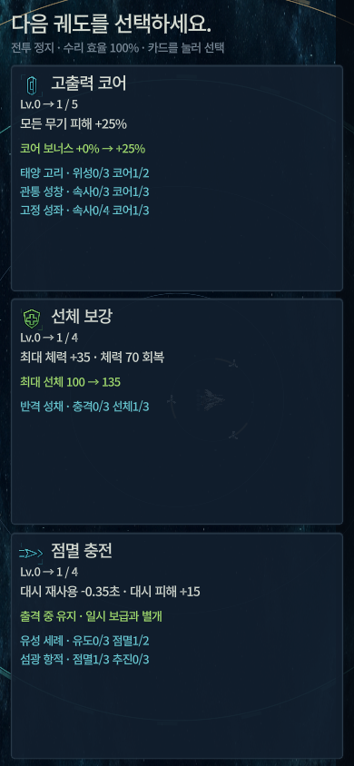

# ORBIT BREAKER 3.19 · 전투 진화와 최종 작전

## 3.19 전투 확장과 코드 검수 보완

아래 웹 플레이 또는 Windows/Web 다운로드로 실행합니다. `audit-20261014`는 진화 이후 6개 전술 분기·보스 코어 공략·환경 역이용·선택형 최종 작전에 더해, 테스트의 실제 진행·터치 경로, 성능 회귀 판정, 빌드 소스/출력 연결, 손상 고스트 방어, 전술 선택 음악과 리플레이 계산을 보완한 세대입니다. [코드 검수 보완·검증 보고서](docs/CODE_AUDIT_IMPLEMENTATION_REPORT.md)와 [전투 확장 보고서](docs/COMBAT_IMPLEMENTATION_REPORT.md)를 참고하세요.

[지금 웹에서 플레이](https://libralightluda.github.io/orbit-breaker/) · [Windows/Web 다운로드](https://github.com/LibraLightLuda/orbit-breaker/releases/tag/v3.19.0)

세라믹·흑연 기체, 흑요석 침공체,3개 우주 전장과 실물 장비/FX,61개 정보 도해를 전체 메뉴·전투·신구고스트에 적용했습니다.125개 제작 대상과95개 아트+2개 브랜딩 리소스이며, 게임 규칙·저장·고스트 형식은3.18을 유지합니다. 모바일 드래그 이동·길게 끌어 놓는 방향 돌진·두 번 탭 오버드라이브와 가로/세로 UI를 지원하며, 데스크톱 키보드/마우스도 유지합니다. 기록은 해당 기기·브라우저에 로컬 저장됩니다.

모바일 가로·세로 모두 메인·출격 준비·강화 선택을 스크롤 없이 사용할 수 있습니다. 0.3초/48px 이상 끌었다 놓으면 해당 방향으로 돌진합니다. 단일 탭은 스킬을 소비하지 않습니다. 가로 전체화면 버튼은 지원 브라우저에서 화면 잠금을 요청하며, 미지원이면 직접 기기를 돌리세요. 하단 스킬 버튼은 즉시 발동합니다.

독자 제작 cue136개·음원195개와 제작 소스, 시작 전 모바일 UI 개선을 함께 배포했습니다. 공개 Web9파일·기본 HTML과 릴리즈6첨부의 SHA-256/크기가 검증본과 일치합니다. 공개 메인·설정·페이지/복귀·출격 준비·회전을 확인했습니다. [사운드 구현과 한계](docs/SOUND_IMPLEMENTATION_REPORT.md) · [시작 전 모바일 UI 검수](docs/PREGAME_MOBILE_REPORT.md) · [최종 검증](docs/VALIDATION_V3.md) · [아트 구현/품질 보고서](docs/ART_IMPLEMENTATION_REPORT.md) · [전체 제작 목록](docs/ART_ASSET_MATRIX.md).

## 기존3.18 게임 규칙과 변경 기록

3.18: 기체 전용3종+공통3종으로 무기 진화12종, 아이템12종, 기체별전용파츠강화2종씩을 추가했습니다. 타원위성·귀환도끼·지뢰·설치포대·돌진잔상·방벽반격을 조합하세요. 신규공통진화는4분,전용진화는5분부터 조건충족시 자동가동됩니다. TAB 도감의 다음 페이지에서 조건을 확인할 수 있습니다.

웹 플레이: [GitHub Pages에서 실행](https://libralightluda.github.io/orbit-breaker/). 모바일 터치와 데스크톱 키보드/마우스를 지원합니다. 브라우저의 같은 사이트에 로컬 기록이 저장됩니다.

보급35초/파츠45초 소멸,10초전 경고,외곽경험치흐름5px/초.획득알림배경6%/글자60%.스트라이커정지최대+45%,이동시낮은증폭지속.잔해용광로붕괴가속·번개회랑교차번개·외곽고리고속포위로기체상성이강해졌습니다.세부수치는 docs/SURVIVAL_V3.md의3.18절이우선합니다.

3.17 플레이 피드백: 우측 상단에서 업적·도감 해금·무기/기체 진화를 도형과 색으로 순차 알림합니다. 아래 점수·경험치 획득 수량과 배율은 새 획득까지 유지합니다. 상단 배경은12% 불투명도로 낮추고 정지 버튼은28×28 아이콘으로 줄였습니다. 좌클릭 돌진 완료 시 Windows 커서를 실제 끝점으로 이동하며 마우스를 다시 움직일 때까지 기체가 정지합니다. 웹은 끝점 조준표로 대체합니다.

Windows 기록·랭킹·고스트·설정은 `%APPDATA%/OrbitBreaker/profile/`에 저장하여 실행 파일 교체와 버전 변경 후에도 이어집니다. 첫 실행에 기존 기록·백업·고스트를 검증 복사하며 원본을 보존합니다. 웹 기록은 같은 브라우저의 같은 사이트 저장소에 남습니다. [모바일 검증과 한계](docs/MOBILE_WEB_REPORT.md) · [최종 검증](docs/VALIDATION_V3.md).

3.16 HUD: 좌측에 선체·순회복/손실·추진 계기판을 모으고, 중앙에 시간·현재 지역·전장 상태·기체 특성·미션을 통합했습니다. 점수는 금색 육각, 경험치는 청록 마름모로 우측 상단에 획득 즉시 표시합니다. 위험지역 보상은 획득 숫자 옆의 색·단계점·배율로 표시하며 전투 중 긴 배율 안내는 없앴습니다. 연속 획득은 합산하고 효과 줄이기에서도 숫자·기호를 유지합니다.

3.15 규칙: 중반부터 모든 적이 점차 강해지고 레벨10 이후 경험치 요구량이 더 빠르게 증가합니다. 파츠는 A급 미션1개 또는90초부터105초 간격의 깊은 외곽2층 탐사에서만 나옵니다. 외곽1/2/3층은 경험치·처치점수×1.25/1.6/2.1이며 선체 노출 손상·감속을 감수해야 합니다. 전장 지형 위험은 점진적으로 넓어지고 동시 발생이 최대3개로 증가합니다. 5~8분 모든 수리 효율은100→30%로 감소하며 이후30%입니다. 행성 방어는 선체가 원에 닿으면 유지되며, 횟수는 정수·방향은화살표+대상 기호로 구분합니다. [변경 수치](docs/GAMEPLAY_FEEDBACK_3_15.md) · [모바일 검증과 한계](docs/MOBILE_WEB_REPORT.md) · [최종 검증](docs/VALIDATION_V3.md).

3.13 UI/UX: 선체·회복·추진 HUD, 강화 전후 수치/진화 연계, 기체·전장 미리보기, 기존 도감·업적 진행 표시, 결과/저장 상태와 작은 화면 메뉴를 개선했습니다. 게임 규칙과 저장 형식은3.12를 유지합니다. [단계별 기록](docs/UIUX_PROGRESS.md)과 [모바일 검증과 한계](docs/MOBILE_WEB_REPORT.md) · [최종 검증](docs/VALIDATION_V3.md)을 확인하세요.
좌클릭/Space 돌진은 커서 방향으로고정188px 추진합니다. 00:50 첫공개 후매분50초 선택미션·10초휴식이 반복되며 C/B/A성공은추가강화1/2/3회, A급만파츠1개를 줍니다. 화력·추진·장갑파츠를 A급미션/외곽2층깊은 탐사에서모아돌격창기병·쌍열포대·기동방벽·삼위일체로 진화합니다. TAB기체테크트리에서조합법과I/II효과를 확인하세요. 총61개업적, 기존기록/설정/고스트보존.

3.11: 번개 회랑의 전기 통로가 외곽 3층까지 전체 전장을 관통합니다. 모든 전장에 블랙홀·행성 방어·유성우·태양 플레어가 발생하며, 위치 표시와 10초 사전 알람을 제공합니다. 표준에서는 드물게, 상위 난이도에서는 더 자주 발생합니다. 행성 방어는 한 판에 한 번만 등장하며 방어 원 안에서 연속 12초를 버티면 5,000점·경험치 45·A급 출력 코어를 얻습니다. 감전·폭발·유성·플레어·외곽 손상의 피격 신호와 타격 파편·발동음을 강화했습니다.

우주 생존 액션: 이전 버전 지름의 80%로 압축된 원형 활동영역에서 외계 침공을 막고 최대 10분까지 생존하세요. 바깥의 희박권·붕괴권·소멸권은 단계마다 손상과 감속이 강해집니다. 2층까지 우회·교전할 수 있고 깊은 3층은 위험합니다. 적은 포위·돌진·진로 차단·거리 유지 사격으로 공격합니다. 기체 바로 아래의 초록/금색 게이지로 돌진과 오버드라이브를 확인하세요.

Windows 기본 창은 1600×900으로 확대했습니다. 활동 반지름은 약 489px, 외곽 각 층은 144px이며 실제 전장 전체를 80%로 줄여 위험 구역이 더 가까워졌습니다.

스트라이커는 정지1.2초에 자동포 피해 최대+60%의 조준 스택을 쌓고, 이동 시3초에 걸쳐 감소합니다. 돌진 중 스택을 유지하고 실제 피격 시 초기화합니다. 상단 HUD는 반투명 배경과 글자 외곽선으로 전장 가시성을 높였습니다.

- 웹: https://LibraLightLuda.github.io/orbit-breaker/ (공개 상태는 검증 문서 참조)
- Windows: build/current/OrbitBreaker.exe
- 소스: Godot 4.7.1 stable Compatibility에서 project.godot를 열고 F5

50개 단계별·플레이 스타일 업적과 영구 업적 점수, 표준 → 베테랑 → 대붕괴 해금, 카메라가 따라가는 외곽과 자연스러운 복귀 흐름을 제공합니다. 출격 준비에서 이름을 입력하고 난이도별 로컬 상위 10명 랭킹의 고스트를 관전하세요. 같은 이름은 같은 파일럿이며 업적·해금·전체 통계는 기기 내 공유합니다. 새 고스트는 적·탄환·아이템 드롭/획득·경험치·위험 구역·버프·전투 효과까지 전장 상태를 기록합니다. 0.2초 간격 스냅샷의 위치를 보간하며 일시정지·배속·앞뒤 탐색을 지원합니다. 기존 고스트는 비행 경로 전용으로 계속 재생합니다.

마우스/WASD/방향키 이동, 좌클릭/Space 대시, 우클릭/E 오버드라이브, Tab 도감, Esc 정지, 1/2/3 강화, M 음소거, F11 전체 화면. 공격은 자동입니다. 안전 구역 바깥은 노출 피해·감속·복귀 흐름이 강해집니다. 안쪽 대시로 돌아오세요.

온라인 서버나 계정은 없습니다. 기존 기록·설정을 보존하며 새 랭킹은 3.1부터 시작합니다. 웹 기록은 해당 브라우저에만 남고 Windows/다른 기기와 동기화되지 않습니다. 사이트 데이터 삭제나 시크릿 창 종료는 기록 소실의 원인이 됩니다. 웹은 데스크톱 키보드·마우스를 대상으로 합니다.

빌드는 tools/build.ps1로 검사 후 build/candidate에 생성합니다. 정상 배포를 먼저 덮어쓰지 않으며 검증 완료 후 최신 검증 완료 버전 한 세대만 보관하며, 직전본을 포함한 구버전 배포·대응 검증 자료를 정리합니다.

[통합 게임 기획서](docs/SURVIVAL_V3.md) · [검증](docs/VALIDATION_V3.md) · [보관 정책](docs/ARTIFACT_RETENTION.md)

Noto Sans KR: assets/fonts/OFL.txt (SIL Open Font License 1.1). Godot 라이선스는 게임 제작 정보에서 확인할 수 있습니다.

아이템은 12종 × C/B/A등급이며 접촉 즉시 발동합니다. 출력·추진·속사·나노봇·즉시 회복·마비·EMP·광전 회로가 등장합니다. A 광전 회로는 5초간 자동포 공격 속도 +300%(4배)입니다. 정예는 B/A, 보스는 A를 확정 드롭하며 외곽 보급은 고등급 확률이 높습니다. TAB 도감의 아이템 탭에서 획득한 종류의 모든 등급 효과를 확인하세요. 발견은 즉시 로컬 저장되며 획득·A등급·위험지역 회수·8종 발견 업적 10개를 추가했습니다.

경계지역의 아이템은 초당18px, 경험치는 초당5px로 중앙 방향의 안전 구역 안쪽까지 서서히 이동합니다. 수집 자석·아이템 수명·등급은 유지되며, 도감/강화/일시정지에서는 이동도 멈춥니다.

3.8 플레이 피드백 반영: Windows 고스트 압축/저장을 별도 스레드로 처리하고 완료 후 랭킹에 연결합니다. 점수는 먼저 저장되며 저장 중 재출격할 수 있습니다. 웹은 한 프레임씩 나눠 저장합니다. 고스트 저장 완료 알림 전에 앱/탭을 닫으면 점수는 남지만 해당 고스트는 없을 수 있습니다.

5분 이후 매분 첫20초는붕괴피해45%완화. 정예는5분부터35→20초간격, 추격지휘체는5분30초부터50→35초간격으로 등장합니다. 각각동시2기한도이며 첫보스격파와독립적입니다. 5분이후지휘체격파는25초붕괴완화와추가점수/경험치를줍니다. 수리효율저하와10분강제종료가함께적용됩니다.

관통 성창(속사3+코어3), 절대 영도(빙결3+확장궤도2), 중력 신성(충격파3+수집기2)을 더해 기존 진화6종에 새6종을 더해 총12종입니다. 빙결/유도탄/번개/충격파는 Lv.5까지 성장합니다. 진화 도감에서 조건과 숙련 효과를 확인하세요.

3.9: 모든 기체에서 좌클릭 돌진은 초록 삼각형, 우클릭 오버드라이브는 금색 원형 게이지로 구분합니다. F11 전체화면과 16:10/21:9 창에서도 도형 비율을 유지하며 검은 여백 없이 전장을 넓혀 표시합니다.
